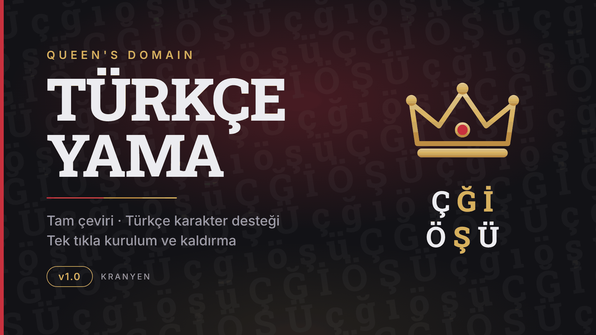
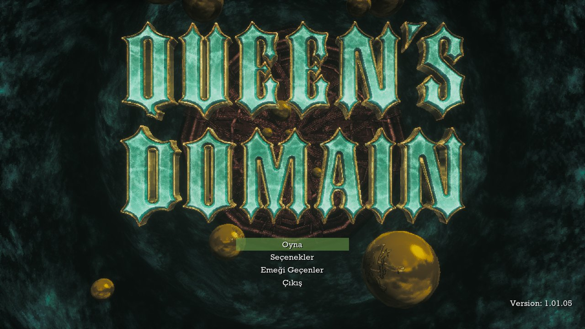
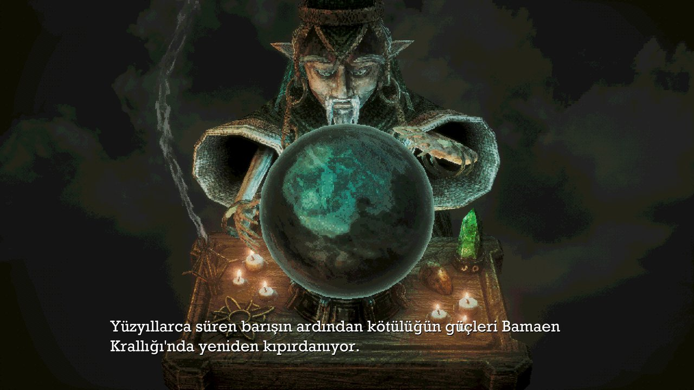
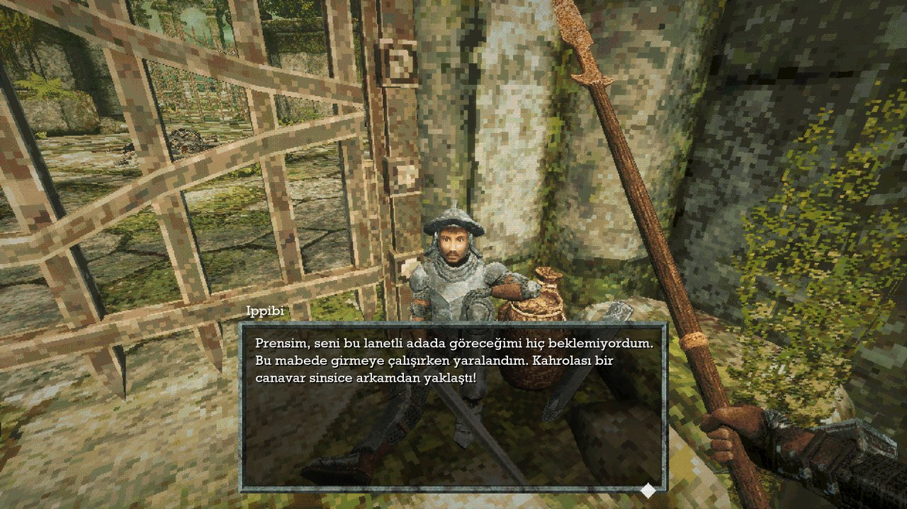
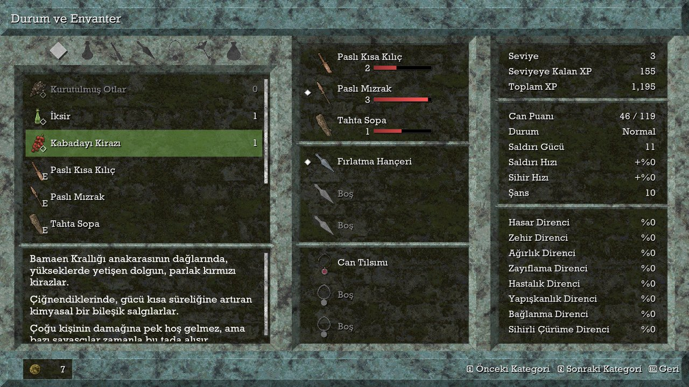
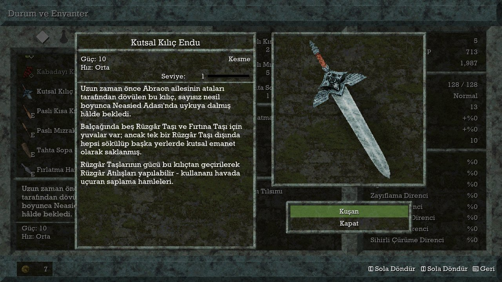

# Queen's Domain — Türkçe Yama

*Queen's Domain* için hayran yapımı Türkçe çeviri: oyunun tüm metinleri Türkçe, Türkçe harfler (Ç Ğ İ Ö Ş Ü) oyunun yazı tipinde düzgün görünür.

**[⬇ Son sürümü indir](../../releases/latest)**

| | |
|---|---|
| Yama sürümü | 1.0.0 |
| Uyumlu oyun sürümü | Steam, yapı 13540 (Kasım 2026) |
| Kapsam | 2.338 / 2.338 metin (%100, ~32.000 kelime) |
| Gereksinim | Windows 10 (1903+) / Windows 11 ya da Steam Deck (elle kurulum), Steam'den edinilmiş Queen's Domain |
| Hazırlayan | KRANYEN |

## Özellikler

- Menüler, diyaloglar, eşyalar, görevler, öğretici ekranlar ve altyazıların tamamı Türkçe
- Oyunun yazı tipinde eksik olan Ğ ğ İ Ş ş harfleri aynı görünümde eklendi
- Oyun dosyalarına dokunulmaz: yama ayrı bir `.pak` dosyası olarak `Content\Paks\~mods` klasörüne eklenir
- Kurulum programı oyunu Steam kütüphanelerinde otomatik bulur ve oyun sürümünü denetler
- Hata olursa kurulum otomatik geri alınır
- Oyun klasöründeki **Türkçe Yamayı Kaldır.exe** ile tek tıkla kaldırma

## Ekran görüntüleri

| | |
|:---:|:---:|
|  Ana menü |  Açılış anlatımı |
|  Diyalog |  Durum ve envanter |
|  Eşya açıklaması | |

## Kurulum

1. Oyunu kapatın, [son sürümden](../../releases/latest) `QueensDomain_TurkceYama_v1.0.0.zip` dosyasını indirip çıkarın.
2. `QueensDomain_TurkceYama_Setup.exe` dosyasını çalıştırın ve **Kur**'a basın.
3. Oyun dili İngilizce ise oyun doğrudan Türkçe açılır. Başka bir dil seçtiyseniz: **Options → Language → Türkçe**.

> **"Windows bilgisayarınızı korudu" uyarısı:** Kurulum dosyası dijital olarak imzalı değildir; **Ek bilgi → Yine de çalıştır** deyin. Dosyayı sürüm sayfasındaki `SHA256SUMS.txt` ile doğrulayabilirsiniz.

**Elle kurulum:** `Elle_Kurulum\zz_QueensDomain_TR_P.pak` dosyasını `...\steamapps\common\QueensDomain\QueensDomain\Content\Paks\~mods\` klasörüne kopyalayın. Kaldırmak için dosyayı silin.

## Steam Deck

Yama Steam Deck'te test edildi ve sorunsuz çalışıyor. Kurulum programı Windows içindir; Steam Deck'te yama elle kurulur:

1. **Masaüstü Moduna** geçin: Steam tuşu → Güç → *Masaüstüne Geç*.
2. Zip'i indirin; Dolphin'de sağ tık → **Ayıkla → Arşivi buraya ayıkla**.
3. Steam'de *Queen's Domain*'e sağ tık → **Yönet → Yerel dosyalara göz at**.
4. `QueensDomain/Content/Paks/` içinde `~mods` klasörü yoksa oluşturun ve `Elle_Kurulum/zz_QueensDomain_TR_P.pak` dosyasını oraya kopyalayın.
5. Oyun Moduna dönüp oyunu başlatın. Kaldırmak için dosyayı silin.

## Kaldırma

Oyun klasöründeki **Türkçe Yamayı Kaldır.exe** → **Kaldır**. Ya da *Ayarlar → Uygulamalar → Queen's Domain Türkçe Yama*.

## Bilinen sorunlar

- Kayıt yuvası ekranında bölge adları oyunun İngilizce büyük harf kuralıyla "GIRIŞ" gibi görünebilir.
- Birkaç kısa düğme metni dar alanlara sığmayabilir.
- Oyun güncellendiğinde yeni eklenen metinler yama güncellenene kadar İngilizce görünür.

Hata bildirmek için **Issues** sekmesini kullanın; mümkünse ekran görüntüsü ekleyin.

## Yapay zekâ kullanımı

Çeviri metinleri, kurulum programı ve bu sayfa Anthropic Claude ile hazırlanmıştır. Çeviriler terim sözlüğü ve otomatik denetimlerle kontrol edilmiş, oyun içinde denenmiştir; henüz satır satır insan onayından geçmemiştir. Proje yönetimi ve testler: KRANYEN.

## Yasal not

Bu bir hayran çevirisidir. *Queen's Domain*, Freshly Baked Games'e aittir; bu proje resmî değildir ve geliştiriciyle bağlantılı değildir. Yama oyunu içermez ve DRM'ye dokunmaz.

Türkçe harf eki [Roboto Slab](https://github.com/googlefonts/robotoslab) yazı tipinden türetilmiştir — Copyright 2018 The Roboto Slab Project Authors, [Apache License 2.0](lisanslar/LICENSE-RobotoSlab.txt). Oyunun kendi yazı tipi dağıtılmaz.

Lütfen yamayı izin almadan başka sitelerde yeniden yayınlamayın; bağlantı paylaşmak serbesttir.
